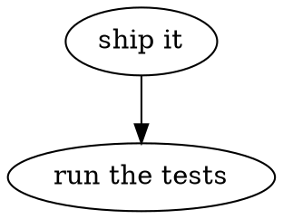

# The contract

Each record has required elements. Both runtimes allow and keep extra fields.
The [Node.js validator](src/mjs/contract.mjs) and [Python validator](src/py/contract.py)
enforce this page. Shared tests keep the validators in step with the contract.

| Movement | Record | File in `.spiral/` | Required elements |
|---|---|---|---|
| Observe | event: what moved | `journal.jsonl` | `id`, `at`, `type`, `actor`, `data` |
| Apply | state: where things stand | `state/<key>.mdx` | `key`, `value`, `at`, `cause`, `version` |
| Learn | relation: what connects | `memory.dot` | `from`, `type`, `to`, `weight`, `evidence` |

**Events** are the truth: one JSON object per line, only ever appended.
`actor.role` is `person`, `agent` or `tool`; `id` looks like `e-…`; `at` is UTC.

**States** are MDX documents. The template started from the 5W2H template in
[templates/state.mdx](templates/state.mdx). `cause` is the event that set the value;
`version` increments by one on every change.

**Relations** are weighted, directed vectors.

One edge per line, names in double quotes (`\"` escapes), `type` a lowercase verb.
Other attributes such as `color` are kept. A line that cannot be read is skipped, never guessed.

Records the contract refuses go to `.spiral/rejected.jsonl`, with the reasons.
