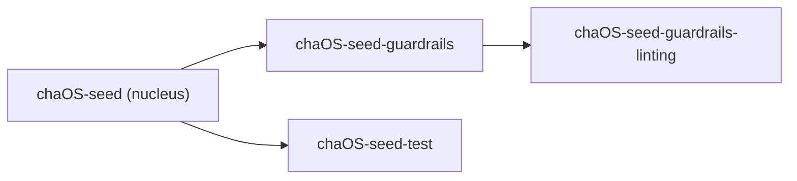

# Coordination

## Dependency graph

Each arrow points from a node declaring a direct dependency to the
node it pins. chaOS-seed starts the current cascade and supplies the
staged snapshot of its code and canonical scenarios.

The dependency graph comes from the manifests owned by those nodes.
Guardrails declares linting in its own manifest and uses the shared
launcher to resolve it. A future nucleus can declare its own direct
dependencies, including nodes already used by chaOS-seed.
[Archive pins](../../scripts/README.md#archive-pins)

## Related repositories

- Coordinates the pre-commit checks. [chaOS-seed-guardrails](https://github.com/fountain-of-love/chaOS-seed-guardrails/blob/main/README.md)
- Defines the Python and Node.js lint rules. [chaOS-seed-guardrails-linting](https://github.com/fountain-of-love/chaOS-seed-guardrails-linting/blob/main/README.md)
- Runs the canonical scenarios in both runtimes. [chaOS-seed-test](https://github.com/fountain-of-love/chaOS-seed-test/blob/main/README.md)

## Path ownership

| Ownership | Paths and responsibilities |
| --- | --- |
| Runtime portals | `bin/`, agent `hooks/`, and `src/`. |
| Guardrails | The `make test` target and the manifest that pins its linting subrib. |
| Linting subrib | Python and Node.js lint rules, exposed through `make test`. |
| chaOS-seed | `.githooks/`, the root `Makefile` interface, `scripts/check.sh`, `scripts/README.md`, and `scripts/ribs.conf`. |
| Test rib | Runtime-specific step definitions, support modules, runner configuration, and test dependencies. |
| Shared | `CONTRACT.md`, `templates/`, the canonical Gherkin under chaOS-seed's `test/features/`, shared Make interfaces, and the branch policy. |

Topics start from their immediate parent and propose changes back to it.
The terminal `/tip` in names such as `codex/ribs/guardrails/linting/tip`
lets parent and child topics coexist. Reviewers check proposed paths
against the receiving branch's ownership rules. When two ribs share
a contract, maintainers of both approve changes to it.
[Branch and review workflow](../execution/README.md#start-a-topic)
